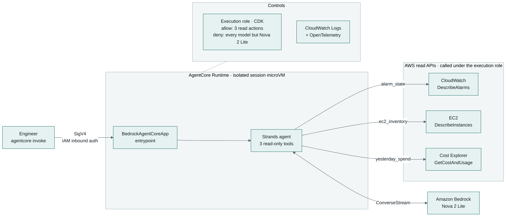
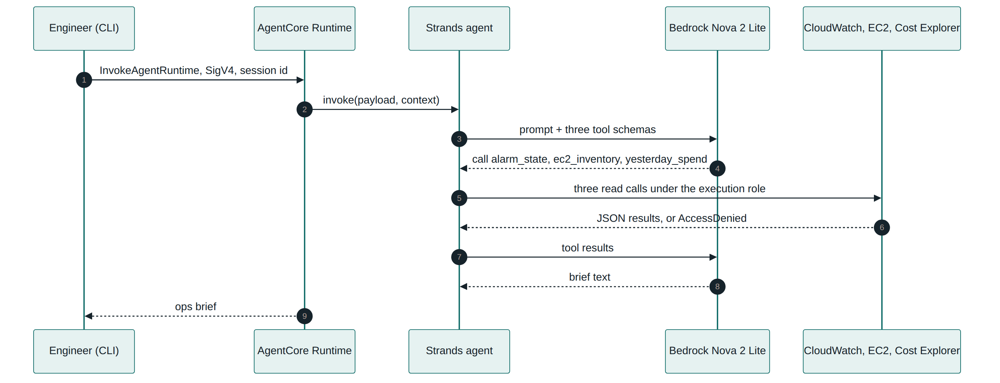

# Ops Brief Agent on Amazon Bedrock AgentCore

A daily AWS operations brief, rebuilt as a tool-calling agent on **AgentCore Runtime**. It reads alarm state, running EC2 instances and yesterday's spend, and writes a short brief from what those three read-only tools return.

It is the second version of [ops-brief-agent](https://github.com/JhamelT/ops-brief-agent), which does the same job with a scheduled Lambda. This repo exists to answer one question honestly: what changes, in security and in cost, when the model decides which tools to call?



## What's deployed, and what's designed

| Component | Status | Detail |
|---|---|---|
| AgentCore Runtime | **Deployed** | Strands agent, Python, CodeZip build, public network mode |
| Model | **Deployed** | Amazon Nova 2 Lite through the `us.` cross-region inference profile |
| Tools | **Deployed** | `alarm_state`, `ec2_inventory`, `yesterday_spend`. All read-only |
| Execution role | **Deployed** | Defined in CDK. Three read actions, plus an explicit Deny on every Bedrock model except Nova 2 Lite |
| Logs and telemetry | **Deployed** | Runtime logs in CloudWatch, OpenTelemetry through the ADOT distro |
| Gateway, Policy, Memory, Identity | Designed | See [docs/architecture.md](docs/architecture.md). Not deployed yet |
| Schedule and email delivery | Not built | v1 has both. v2 is invoked on demand |

## How one request works

1. The CLI signs `InvokeAgentRuntime` with IAM credentials (SigV4), the Runtime's default inbound auth.
2. Runtime routes the request to an isolated session microVM.
3. The Strands agent sends the prompt and three tool schemas to Nova 2 Lite. The model decides which tools to call.
4. Each tool calls one AWS read API using the execution role's credentials.
5. The results go back to the model, which writes the brief from those results only.
6. The response streams back to the caller, and the run is logged.



## Security design

**The tools cannot change anything.** There is no tool that writes, tags, stops or terminates a resource, and no permission in the role that would allow it. A prompt injection or a confused model can produce a wrong sentence. It cannot change the account.

**Least privilege lives in code.** The execution role is extended in [`agentcore/cdk/lib/cdk-stack.ts`](agentcore/cdk/lib/cdk-stack.ts):

- `cloudwatch:DescribeAlarms`, `ec2:DescribeInstances`, `ce:GetCostAndUsage`. All three are scoped to `*` because none of them support resource-level permissions. That exception is written next to the statement, so a reviewer doesn't have to guess whether it was deliberate.
- An explicit **Deny** on `bedrock:InvokeModel` and `bedrock:InvokeModelWithResponseStream` for every resource except the Nova 2 Lite inference profile and foundation model. The construct's generated policy allows invoking any model in any region. An explicit deny outranks that allow, so the fix doesn't have to fight the construct.

**The account ID stays out of the repo.** `agentcore/aws-targets.json` and `agentcore/.cli/deployed-state.json` carry the account ID and resource ARNs, so they are gitignored. Copy [`aws-targets.example.json`](agentcore/aws-targets.example.json) to deploy your own.

## What deploying it taught me

**1. It worked locally and failed closed in the cloud.** `agentcore dev` runs the agent on your machine with your credentials. Mine are admin, so every tool worked. The first invocation in Runtime returned AccessDenied on all three tools, because the execution role had none of those permissions. The agent reported the three errors instead of inventing a brief. I granted exactly the actions the tools call and redeployed. ([before](docs/evidence/01-invoke-before-read-policy.txt), [policy diff](docs/evidence/02-deploy-add-read-policy.iam-diff.txt), [after](docs/evidence/03-invoke-after-read-policy.txt))

The lesson: local testing under admin credentials hides the bugs that matter most. Test locally under a role that mirrors the execution role.

**2. The generated role could invoke any model.** Reading the whole generated policy, not just the part I added, turned up `InvokeModel` on every model and inference profile in every region. For an agent that uses one model, that is a cost and data exposure problem. I added an explicit Deny on every other model ([diff](docs/evidence/04-deploy-add-model-deny.iam-diff.txt)) and confirmed the brief still runs on Nova 2 Lite ([after](docs/evidence/05-invoke-after-model-deny.txt)). A policy simulation against the role then returned `explicitDeny` for Nova Pro, and `allowed` for Nova 2 Lite through both its inference profile and the model ([simulation](docs/evidence/07-simulate-model-deny.txt)).

**3. The first bootstrap failed on an orphaned bucket.** A CDK staging bucket from an old bootstrap was still in the account after its stack was gone. The bucket was versioned, so deleting the visible objects wasn't enough. Old versions and delete markers had to be cleared before a clean bootstrap could run. Same class of problem as losing Terraform state: the tool wants to create something that already exists.

**4. Correct numbers, wrong judgement.** The brief told me to investigate two alarms that were doing their job: auto scaling `AlarmLow` alarms that sit in ALARM whenever an ECS service is idle. It also used markdown on every run, despite a system prompt that says not to. Both are in the [evidence notes](docs/evidence/README.md#things-the-output-shows-that-i-didnt-design-for). The takeaway: grounding stops the model inventing facts. It doesn't give the model the context to know which facts matter.

## Measured: flexibility has a price

| | v1: Lambda | v2: AgentCore Runtime |
|---|---|---|
| Who calls the AWS APIs | Python, always all three | The model decides |
| Model's job | Narrate a finished JSON object | Choose tools, then narrate the results |
| Tokens per run | About 350 | About 3,700 in, 370 out |
| State | DynamoDB row for the day-over-day diff | None yet |
| Infrastructure as code | Terraform | CDK, through the AgentCore CLI |

Roughly ten times the tokens for the same brief. For a fixed daily report, that is a bad trade, and v1 is the better design. For an on-call engineer asking arbitrary questions about an account, tool calling is the right one. The security posture is the same either way, because the tools are read-only.

## Run it

Prerequisites: an AWS account with Bedrock access to Nova 2 Lite, Node.js 20+, Python 3.10+, [uv](https://github.com/astral-sh/uv), and the AgentCore CLI.

```bash
npm install -g @aws/agentcore
cp agentcore/aws-targets.example.json agentcore/aws-targets.json   # add your account ID

agentcore dev                      # local, with an inspector; runs under YOUR credentials
agentcore deploy                   # CDK synth, bootstrap, deploy
agentcore invoke --prompt "Give me today's ops brief."
agentcore status
```

Tear down:

```bash
agentcore remove all
agentcore deploy
```

## Repo layout

```
app/OpsBriefAgent/
  main.py            Strands agent, system prompt, the three tools
  collectors.py      boto3 calls behind each tool (shared with v1)
  model/load.py      model id: us.amazon.nova-2-lite-v1:0
agentcore/
  agentcore.json     runtime definition
  cdk/lib/cdk-stack.ts   execution role additions: read actions and model Deny
docs/
  architecture.md    deployed and target architecture
  evidence/          raw outputs from the deploy, account ID masked
scripts/
  export_evidence.py copies CLI logs into docs/evidence with identifiers masked
```

## Next

0. Filter auto scaling alarms out of `alarm_state`.
1. Move the tools behind **AgentCore Gateway** as a Lambda target, with a Cognito JWT authorizer. The read permissions then move to the target's role, and the agent can no longer reach AWS directly.
2. Add **Policy** at the Gateway: default deny, permitting only the three read tools.
3. A prompt-injection regression test: a planted instruction in a resource tag, run against every change.
4. **Memory** to replace v1's DynamoDB diff, with extraction limited to tool results to avoid memory poisoning.
5. VPC network mode with interface endpoints, so the agent has no internet path.

## The decision I'm most proud of

Keeping the tools read-only when making them do more would have made a better demo. Everything else in the security design depends on it. Authorization, auditing and injection defense are all easier when the worst outcome is a wrong sentence.

An agent is only as safe as the least-reviewed line in its execution role.
