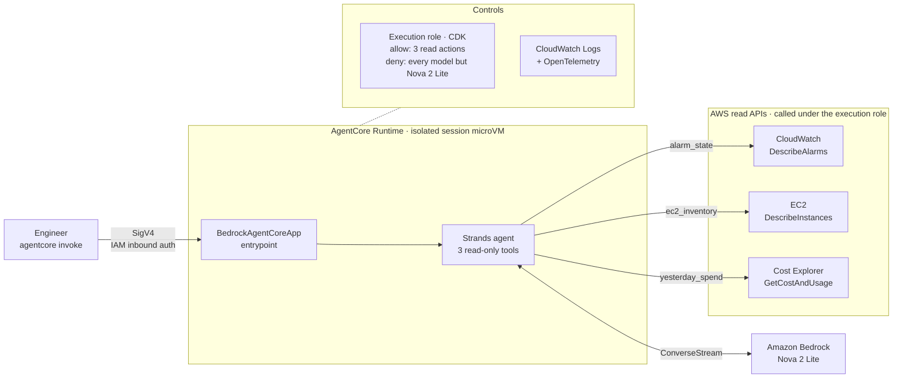
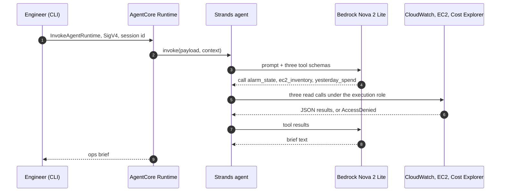
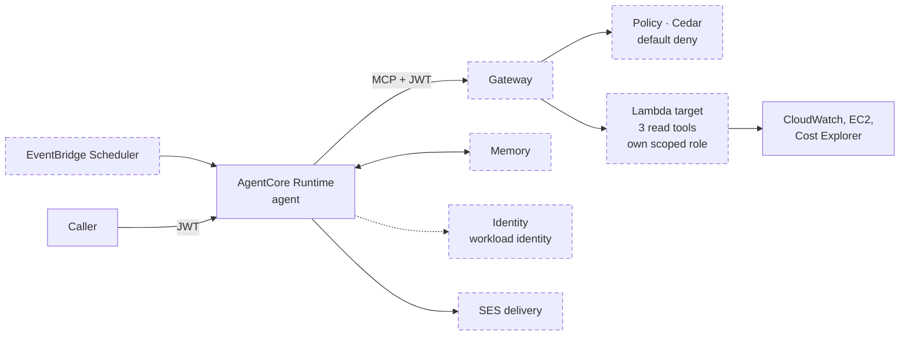

# Architecture

## Deployed

## One request

## Deploy path

`agentcore deploy` synthesizes the CDK app into a CloudFormation template, bootstraps the account if needed (staging bucket and deploy roles), uploads the code zip to the staging bucket, and deploys the stack `AgentCore-opsbriefagentcore-default`, which creates the Runtime, its execution role and its log group.

A note for deploying into someone else's account: CDK's default bootstrap roles are broad. In a client account, bootstrap with `--trust` limited to the deploying account and a permissions boundary, or deploy from the pipeline role they already run.

## Target (dashed boxes are designed, not deployed)

The change that matters most: once the tools sit behind Gateway in a Lambda target, the three read permissions move to that target's role. The agent's own execution role keeps only model invocation and telemetry. The agent can no longer reach AWS directly; it can only ask the Gateway, and Policy decides whether to let it.

| Component | Planned configuration | Main risk it addresses or introduces |
|---|---|---|
| Gateway | Lambda target, Cognito JWT inbound, pinned client and audience | One authenticated, audited entry point for tools |
| Policy | Cedar, default deny, permit the three read tools for this agent only | Excessive agency, enforced outside the prompt |
| Memory | Short-term events plus a narrow summary strategy, namespaced by verified actor ID | Introduces memory poisoning; extraction limited to tool results |
| Identity | Workload identity; token vault only if a third-party API is added | Keeps outbound credentials out of agent code |
